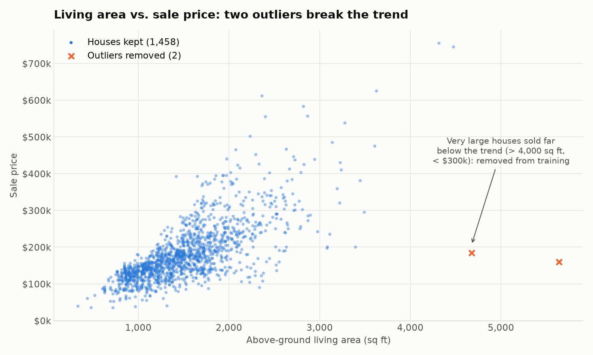

# House Price Prediction: Regularised Linear Regression

Predicting residential sale prices in Ames, Iowa from 79 property characteristics, using the [Kaggle *House Prices: Advanced Regression Techniques*](https://www.kaggle.com/competitions/house-prices-advanced-regression-techniques) dataset.

The project goes through the full workflow: exploring the data, cleaning it, building features, then choosing and interpreting a model. The focus is on **careful, well-justified data cleaning** and on **understanding why** some models predict better than others, not only on getting a score.

| | |
|---|---|
| **Final model** | Lasso regression (α ≈ 0.0029) |
| **Cross-validated RMSE (log price)** | **0.1131** (10-fold) |
| **Kaggle public score** | **0.13329** |
| **Baseline (always predict the mean)** | 0.40 |
| **Tools** | Python · pandas · NumPy · scikit-learn · matplotlib · seaborn |

---

## Business question

> *Given a house's size, quality, location and amenities, what price should we expect it to sell for, and which characteristics drive that price?*

A model like this is useful for pricing listings, spotting over- or under-valued properties, and explaining to buyers and sellers what adds value to a home.

---

## Approach

### 1. Target variable
`SalePrice` is strongly right-skewed (skewness 1.88; the mean of $181k is above the median of $163k). A log transformation brings the skewness down to 0.12, so the model predicts **log(SalePrice)**. This also matches the competition metric, the RMSE of the log price.

### 2. Exploratory analysis and outliers
- The variables most correlated with log price are **OverallQual (0.82)**, **GrLivArea (0.70)** and **GarageCars (0.68)**.
- A scatter plot of living area against price shows **two very large houses that sold far below the trend**. They were removed from the training set. After that, the correlation between GrLivArea and price rose from 0.70 to 0.73.



### 3. Missing values: checked column by column, not filled blindly
Before filling a missing value, I checked what it actually meant by cross-tabulating it against related columns:

| Situation | Example | Treatment |
|---|---|---|
| NA means "doesn't have it" | `PoolQC` is NA exactly when `PoolArea = 0`. Same for `FireplaceQu` and `Fireplaces = 0` | Filled with `'None'` / `0` |
| Very sparse feature | Pool exists for only 0.4% of houses | Replaced by a binary `has_pool` flag |
| Real missing data | `LotFrontage` (16.7% missing) | **Neighbourhood median**, computed on train only |
| Inconsistent records | A house has a garage type but no area; masonry veneer area = 1 sq ft | Handled case by case and documented |
| Redundant variable | `GarageYrBlt`: 0.83 correlation with `YearBuilt`, equal in 76% of houses, contains an impossible year (2207) | Dropped |
| A few scattered NAs | 11 values across 7 categorical columns | Mode of the **training** set |

All imputation statistics (medians, modes) come **only from the training data**, so no information leaks from the test set.

### 4. Feature encoding
- **Ordinal encoding** for the 8 quality scales (`Po` < `Fa` < `TA` < `Gd` < `Ex`). Before encoding, I checked that mean price really rises with each level. `ExterCond` did not follow that pattern, so it was one-hot encoded instead.
- **One-hot encoding** for the other categorical columns. `MSSubClass` is a code, not a number, so it is treated as categorical, and its rare levels are grouped as "Other".
- Result: **237 features** and no missing values.

### 5. Modelling
Three linear models were compared with **10-fold cross-validation**. Each one is a scikit-learn pipeline with `StandardScaler`, so the scaling is fitted again inside each fold.

| Model | Tuned α | CV RMSE (log price) |
|---|---|---|
| OLS (Linear Regression) | – | 0.1215 |
| Ridge | 193 | 0.1173 |
| **Lasso** | **0.0029** | **0.1131** |

Lasso was refitted on the full training set and used to produce [`zarah_submission.csv`](zarah_submission.csv).

---

## Key insights

- **Regularisation beats plain OLS.** With 237 correlated features, OLS also fits noise in the training data. Ridge and Lasso both generalise better.
- **Lasso does feature selection automatically.** It sets **136 of 237 coefficients to exactly zero**, which leaves a simpler model with 101 features.
- **Ridge spreads weight, Lasso picks one.** `GrLivArea` ≈ `1stFlrSF` + `2ndFlrSF`. Ridge splits the effect across all three, while Lasso keeps only `GrLivArea`.
- **OLS coefficients can be unstable.** The `MSZoning` dummies are very large in OLS (0.186) because the reference group has very few houses. Ridge and Lasso shrink them to about 0.02.
- **What drives price:** living area, overall quality, year built, overall condition, basement size, newly built homes and neighbourhood (e.g. Crawford). For example, **one standard deviation more living area means about 13.7% higher predicted price**.

---

## Repository structure

```
├── project_1_house_prices_zarah_dominguez.ipynb   # Full analysis (EDA → cleaning → modelling)
├── zarah_submission.csv                           # Final Kaggle predictions
├── images/                                        # Charts used in this README
├── pyproject.toml / uv.lock                       # Reproducible environment
└── house-prices-advanced-regression-techniques/   # Data (not tracked, see below)
```

---

## How to run

1. **Get the data.** Download it from the [Kaggle competition page](https://www.kaggle.com/competitions/house-prices-advanced-regression-techniques/data) and unzip it into a folder called `house-prices-advanced-regression-techniques/` in the project root.
2. **Install dependencies** (Python ≥ 3.14) with [uv](https://docs.astral.sh/uv/):
   ```bash
   uv sync
   ```
   Or with pip:
   ```bash
   pip install pandas numpy scikit-learn matplotlib seaborn jupyter
   ```
3. **Open the notebook** and run all cells:
   ```bash
   uv run jupyter notebook project_1_house_prices_zarah_dominguez.ipynb
   ```

---

## Skills demonstrated

`Data cleaning` · `Missing-data analysis` · `Exploratory data analysis` · `Outlier detection` · `Feature engineering` · `Categorical encoding` · `Linear / Ridge / Lasso regression` · `Hyperparameter tuning` · `Cross-validation` · `Avoiding data leakage` · `Model interpretation`

---

## Author

**Zarah Dominguez**
[GitHub](https://github.com/zarahelisa) <!-- Add your LinkedIn here: · [LinkedIn](https://www.linkedin.com/in/your-profile) -->
